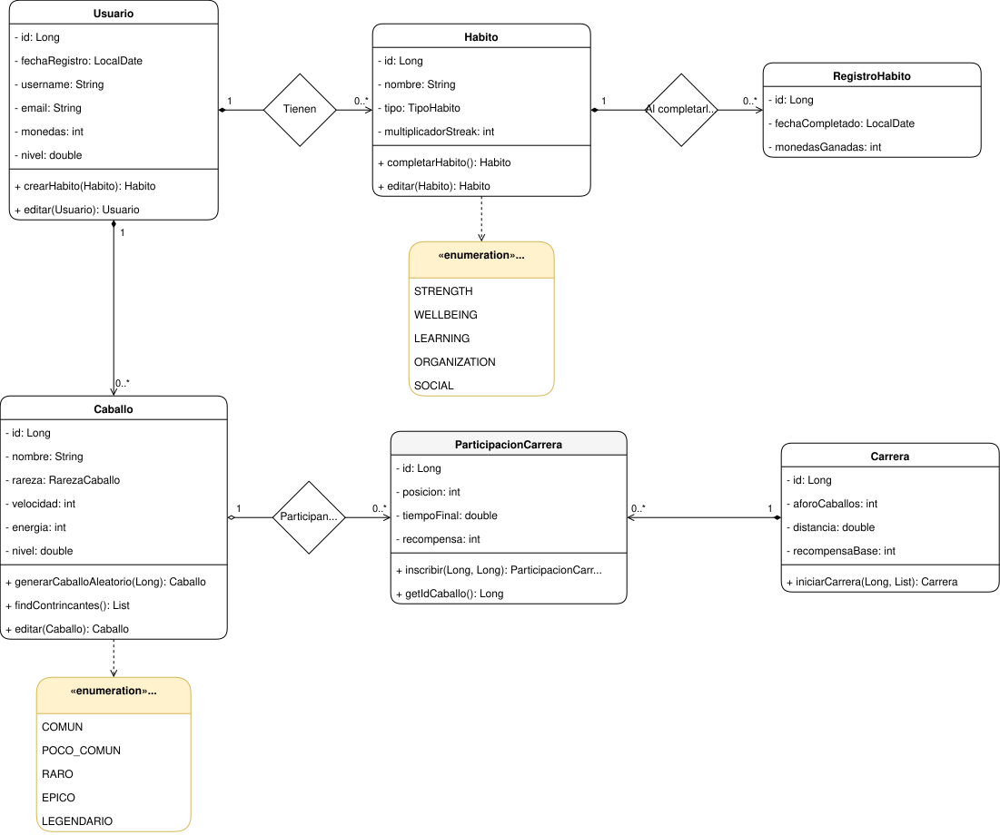

[](https://classroom.github.com/a/buS8y_oD)

# StableUp

StableUp es una aplicación web hecha con Spring Boot para gestionar habitos de forma gamificada. Cuando completas un hábito ganas monedas y experiencia, y con esas monedas puedes conseguir caballos (de forma aleatoria, tipo gacha) que luego compiten en carreras contra los de otros usuarios.

Proyecto final del 3er trimestre para STEM GRANADA.

## Tecnologías usadas

### Backend
- **Java 25**
- **Spring Boot 4** — Spring Web MVC + Spring Data JPA
- **Hibernate** — ORM (mapeo objeto-relacional)
- **H2 Database** — base de datos en memoria
- **JavaFaker** — generación de datos de prueba
- **Maven** — gestión de dependencias y build

### Frontend
- **HTML5**
- **CSS3**
- **JavaScript (ES Modules)** — vanilla, sin frameworks
- **Bootstrap 5** — estilos y componentes
- **Bootstrap Icons** — iconografía

### Herramientas
- **Git / GitHub** — control de versiones
- **JavaDoc** — documentación del backend
- **draw.io** — diagrama de clases UML
- **Postman** — pruebas de la API

## Organización del proyecto

El backend sigue una **arquitectura por capas**, donde cada capa tiene una
responsabilidad y se comunica solo con la siguiente:

- **controller** — recibe las peticiones HTTP (REST) y devuelve las respuestas.
- **service** — contiene la lógica de negocio (interfaz + implementación).
- **repository** — acceso a datos mediante Spring Data JPA.
- **entity** — las clases del modelo, mapeadas a tablas con JPA.

## Requisitos del sistema

- Java 25 (JDK)
- Maven (no hace falta instalarlo, el proyecto trae el wrapper `mvnw`)
- Cualquier cliente para probar peticiones (Postman, Insomnia, curl...)

Se usa H2 en memoria, así que se crea sola al arrancar.

## Compilar y ejecutar

Todos los comandos se lanzan desde la carpeta `stableup`:

Compilar el proyecto:

```bash
./mvnw clean package
```

Arrancar la aplicación:

```bash
./mvnw spring-boot:run
```

Pasar los tests:

```bash
./mvnw test
```

> En Windows usa `mvnw.cmd` en lugar de `./mvnw`.

Una vez arrancado, la app queda en `http://localhost:8080`.

## Consola H2

La base de datos es en memoria, así que cada vez que reinicias la app se borra todo y se vuelve a crear.

Para entrar a la consola y ver las tablas:

1. Arranca la aplicación.
2. Abre en el navegador: `http://localhost:8080/h2-console`
3. Rellena los datos de conexión:
   - **JDBC URL:** `jdbc:h2:mem:StableUp`
   - **User Name:** `sa`
   - **Password:** (déjalo en blanco)
4. Pulsa *Connect*.

## Rutas de la API

Todo cuelga de `/api/v1`. Por ejemplo: `http://localhost:8080/api/v1/usuarios`.

### Usuarios — `/usuarios`
- `GET /usuarios` — listar todos
- `GET /usuarios/{id}` — obtener uno
- `POST /usuarios` — crear
- `PUT /usuarios/{id}` — editar
- `DELETE /usuarios/{id}` — borrar
- `GET /usuarios/{id}/caballos` — caballos del usuario
- `GET /usuarios/{id}/habitos` — hábitos del usuario
- `POST /usuarios/{id}/habitos` — crear un hábito para ese usuario

### Hábitos — `/habitos`
- `GET /habitos` — listar todos
- `GET /habitos/{id}` — obtener uno
- `PUT /habitos/{id}` — editar
- `DELETE /habitos/{id}` — borrar
- `POST /habitos/{id}/completar` — completar el hábito y recibir la recompensa

### Registros — `/registros`
- `GET /registros` — listar todos
- `GET /registros/{id}` — obtener uno
- `POST /registros` — crear
- `PUT /registros/{id}` — editar
- `DELETE /registros/{id}` — borrar

### Caballos — `/caballos`
- `GET /caballos` — listar todos
- `GET /caballos/{id}` — obtener uno
- `GET /caballos/{id}/participaciones` — sus participaciones en carreras
- `GET /caballos/{id}/contrincantes` — caballos de otros usuarios (posibles rivales)
- `POST /caballos/usuario/{usuarioId}` — generar un caballo aleatorio (cuesta 100 monedas)
- `PUT /caballos/{id}` — editar
- `DELETE /caballos/{id}` — borrar

### Carreras — `/carreras`
- `GET /carreras` — listar todas
- `GET /carreras/{id}` — obtener una
- `POST /carreras/iniciar/{idCaballoPropio}` — iniciar una carrera (en el body va la lista de IDs de los rivales)
- `PUT /carreras/{id}` — editar
- `DELETE /carreras/{id}` — borrar

## Diagrama UML

El diagrama de clases está en el archivo [`diagrama-uml.drawio`](diagrama-uml.drawio). Se puede abrir con [draw.io](https://app.diagrams.net/) (o la extensión de draw.io en VS Code).

Resumen de las relaciones:

- Un **Usuario** tiene varios **Caballos** y varios **Hábitos**.
- Un **Hábito** guarda varios **Registros** (uno por cada vez que se completa).
- Un **Caballo** participa en **Carreras** a través de **ParticipacionCarrera**.



## Video explicación
[](https://youtu.be/26Q3oTDxfro)

## Autor

Mario Rodríguez Aguado
